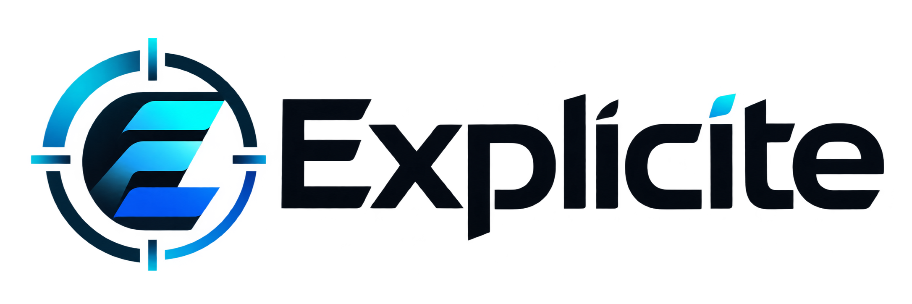

<p align="center"></p>

# 🚀 Explicite — Digital Transformation Consulting

🌐 [Português](README.md) | **English**

🔗 **Open the live app (GitHub Pages):** [Click here to open the app](https://luscamasfei.github.io/explicite/)

> The app interface and the generated report are in Brazilian Portuguese.

## 👥 Responsible Specialists (Authors)
- **Lucas Maffei**
- **Course unit:** Digital Exploration and Technology Fundamentals (*Exploração Digital e Fundamentos Tecnológicos*), Knowledge Objects 05 and 06

---

## 🎯 1. The Business Problem and the App's Goal

Small and medium-sized businesses know they need to modernize, but they don't know where to start: they use an ordinary computer as a server, track sales in disconnected spreadsheets, use AI without a method and share passwords. Explicite implements **Option B, the 360º Digital Maturity Assessment**. With 8 questions, it calculates a Digital Maturity Index (0 to 100%), places the company in one of four stages (Beginner, In Transition, Connected or Digital Leader) and issues a report with a prioritized action plan.

## 🏛 2. The 4 Best Practice Pillars Applied in the Assessment

- **☁ Infrastructure and Cloud Migration:** assesses where systems run and how backups are made. It recommends SaaS, PaaS or IaaS based on the company's type of software (off-the-shelf, custom-built or legacy), along with 3-2-1 backups, restore testing, link redundancy and FinOps.
- **🔄 Business Systems (ERP/CRM) and Data Flow:** assesses integration between departments and the use of metrics. It guides the move away from spreadsheets, CRM and ERP integration through APIs, a single source of truth and management dashboards.
- **🤖 Generative AI and No-Code Automation:** assesses how repetitive tasks are handled and how the team uses AI. It guides bottleneck mapping, pilots with measured gains and human review (human-in-the-loop) to catch hallucinations.
- **🛡 Governance, Ethics and Digital Security (LGPD):** assesses access control and the handling of personal data. It recommends MFA, least privilege, an AI usage policy, anonymization and compliance with the LGPD, Brazil's data protection law, adjusted for sector and company size.

### Scoring engine rules

| Rule | How it works |
| :--- | :--- |
| Scoring | Each answer is worth 0 to 3 points. Pillar = sum of its 2 questions ÷ 6. Overall index = sum of all 8 questions ÷ 24. |
| Stages | Beginner up to 34%, In Transition from 35% to 59%, Connected from 60% to 84%, Digital Leader from 85%. |
| Risk lock | With no backup, shared passwords or personal data in public AI tools, the stage is capped at In Transition, whatever the score. |
| Action priority | Weight = points missing on the question, doubled for critical questions (backup, access and LGPD). Weight 4 or more: within 30 days. Weight 2 or 3: 30 to 90 days. Weight 1: 90 to 180 days. |
| Personalization | The text changes with each answer, the sector, the number of employees and the type of software. |

### Requirements met

| Requirement | Implementation |
| :--- | :--- |
| RF01 Identification | Company name, sector, number of employees and main software. |
| RF02 Data collection by pillar | 8 questions, 2 per pillar. |
| RF03 Scoring engine | Overall score and pillar scores in JavaScript, with no page reload. |
| RF04 Dashboard | Radar chart (Chart.js) and a table of scores by pillar. |
| RF05 Report | Best practice plan generated from the answers. |
| RF06 Demo and export | "Load sample case" and "Print / save report as PDF" buttons (`window.print()`). |
| RNF01 Static cloud hosting | Runs entirely in the browser from `index.html`, with Tailwind and Chart.js via CDN and no build step. CSS and JavaScript live in their own files (see Repository Structure). |
| RNF02 Responsive | Layout tested on desktop and mobile widths. |
| RNF03 Privacy by Design | Nothing is sent or stored. The notice is in the footer. |
| RNF04 Documentation | This file. |

### Repository Structure

```text
├── index.html           Page structure
├── style.css            Visual identity, animations and print styles
├── app.js               Questions, scoring engine, report and chart
├── tailwind.config.js   Tailwind colors and fonts
├── logo.png             Original logo
├── logo-anel.png        Ring layer, used in the animations
├── logo-e.png           E layer, used in the animations
├── logo-nome.png        Light version of the name, for dark backgrounds
├── favicon.png          Browser tab icon
├── README.md            Documentation in Portuguese
└── README.en.md         Documentation in English
```

## 🛠 3. Generative AI and Tools Used

| Tool / AI | How it was used in the project |
| :--- | :--- |
| **Claude Code (Claude Opus 5.5)** | Reading the class PDFs, defining the questions, weights and business rules, writing the recommendations, generating the HTML/CSS/JS code, running automated tests and drafting this README. |
| **TailwindCSS & Chart.js (CDN)** | Responsive styling and the dynamic maturity radar chart. |
| **GitHub & GitHub Pages** | Version control and static cloud hosting (PaaS/CDN). |

## 🧠 4. Build Log: How We Built and Refined the App

1. **Concept and Prompt Engineering:** instead of typing a prompt, we sent the AI the two class PDFs (the slides and the requirements guide), which include the Master Prompt. The AI chose Option B because it is the one the Master Prompt describes, and went beyond it in three ways: the risk lock, the SaaS, PaaS or IaaS recommendation by type of software, and recommendations by sector and company size.
2. **Adjustments and Technical Refinements:** during the build, we asked the AI to rename the app to "Explicite", which changed the title, logo, report stamp and protocol prefix. After the first release, we asked it to make the site as beautiful as possible using CSS and JavaScript. The AI created a visual concept tied to the app's name (*explicitar* means to make explicit): redaction bars that open with each answer, highlighter marks, an ink-textured stamp and animated score counters, while respecting users who prefer reduced motion. We then moved the CSS and JavaScript out of `index.html` into their own files, added the official logo, split into layers for the intro animation, and adopted Conventional Commits. Automated browser tests checked the calculations, the risk lock, live report updates and the print version.
3. **Main Takeaway:** _[Fill in with your personal takeaway about Digital Transformation, Cloud and AI.]_
